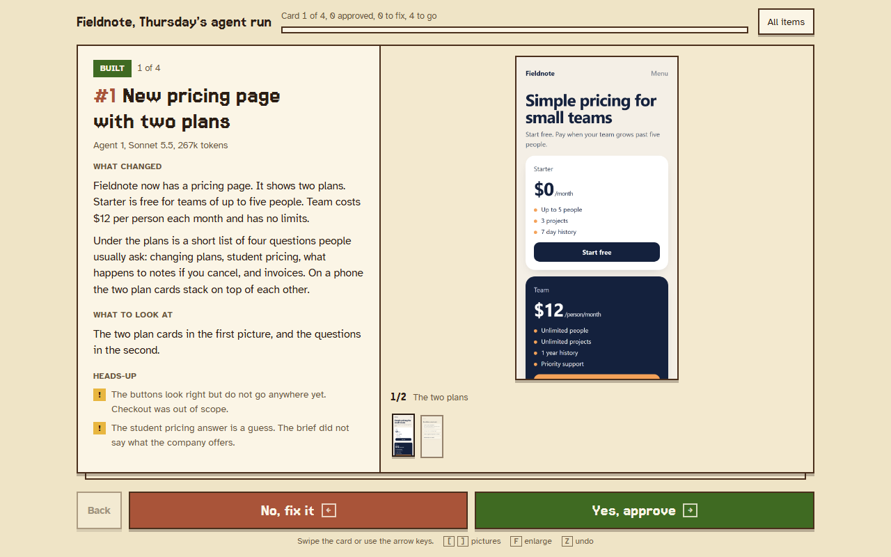

# Clinder

**Swipe through the work your AI agents finished.** Swipe right to approve, swipe left to send it back with a note. Your answers land in a JSON file the agents can read, so they know exactly what to fix.



When you run several agents at once, reading their reports becomes the slow part. Clinder turns each finished task into one card: what changed in plain words, what to look at, the evidence, and anything the agent was unsure about. You go through the pile one card at a time, on a laptop or a phone.

- **Say "use clinder" to your agent.** When the work is done, the review opens by itself, waits for your answers, and hands them back. [How.](#use-it-with-your-ai-agent)
- **Works for anything people build.** Screenshots, screen recordings, a live page to click through, or terminal output and diffs for work with nothing to look at.
- **No install, no dependencies.** Node 18.17 or newer is all it needs.
- **Works offline and stays private.** Nothing loads from the internet and nothing leaves your machine.
- **Two ways to review:** live, while agents are still working, or as one HTML file you can send to someone else.

## Try it

```sh
git clone https://github.com/nicololgallia-creator/clinder
cd clinder
npm run demo
```

Your browser opens on a demo deck of four cards. Answer them and look at `examples/demo/answers.json`.

## Use it with your AI agent

Ask for anything and add **"use clinder"**. When the agent is done, it builds a deck, opens it in your browser, waits until you have answered every card, then fixes what you sent back.

**Claude Code:** install the skill once, for every project:

```sh
npx github:nicololgallia-creator/clinder install-skill
```

Add `--project` to install it into the current project only (`.claude/skills/clinder`), for example to commit it for your team.

**Any other agent** (Codex, Cursor, Gemini CLI, Aider, or your own): print the instructions and paste them into its rules file (`AGENTS.md`, `.cursorrules`, `GEMINI.md`, or wherever it reads them):

```sh
npx github:nicololgallia-creator/clinder install-skill --print
```

Under the hood the agent runs `clinder serve <deck> --wait`, which opens the review and exits once every card is answered, printing the answers. More on writing good cards in [docs/agents.md](docs/agents.md).

## Use it on your own work

You do not need to clone anything. In the folder where your deck lives:

```sh
npx github:nicololgallia-creator/clinder init review     # starts review/cards.json with two example cards
npx github:nicololgallia-creator/clinder serve review    # opens the review in your browser
```

1. Your agents (or you) write `cards.json` and put screenshots next to it.
2. `serve` opens the review. New cards appear on their own as agents add them.
3. Every answer is saved to `answers.json` beside the deck, the moment you give it.
4. Agents read `answers.json` and fix what you sent back.

To review somewhere else, or hand the review to another person, build one self-contained file instead:

```sh
npx github:nicololgallia-creator/clinder build review    # writes review/review.html, pictures included
```

Open it in any browser. When the reviewer is done, **Download answers** gives them the same `answers.json`, and **Copy my notes** gives a plain-text version for chat or email.

All the commands:

| Command | What it does |
| --- | --- |
| `clinder serve [deck]` | Opens the review. Answers are saved to `answers.json` next to the deck. `--port`, `--no-open`, `--answers <file>` |
| `clinder serve [deck] --wait` | The same, then prints the answers and stops once every card is answered. `--timeout <minutes>`, `--json` |
| `clinder answers [deck]` | Prints the answers so far: sent back with notes, approved, still waiting. `--json` |
| `clinder build [deck]` | Makes one self-contained HTML file to send to anyone. `--out <file>` |
| `clinder init [folder]` | Starts a deck with two example cards. |
| `clinder install-skill` | Teaches Claude Code the "use clinder" keyword. `--project`, `--print` |

Run them with `npx github:nicololgallia-creator/clinder <command>`, or `node bin/clinder.mjs <command>` from a clone.

## The deck: `cards.json`

```json
{
  "title": "Thursday's agent run",
  "kinds": { "built": "Built", "decide": { "label": "Your decision", "tone": "ink" } },
  "cards": [
    {
      "id": "pricing-page",
      "kind": "built",
      "title": "New pricing page with two plans",
      "by": "Agent 1, Sonnet 5.5, 267k tokens",
      "summary": ["What changed, in plain words.", "A second paragraph if it helps."],
      "look": "The two plan cards in the first picture.",
      "flags": ["The buttons do not go anywhere yet."],
      "images": [{ "src": "screenshots/plans.png", "caption": "The two plans" }]
    }
  ]
}
```

Only `id` and `title` are required. Everything else is optional.

| Field | What it is |
| --- | --- |
| `id` | Short and unique. Your answer is saved under it. |
| `title` | The name of the change. |
| `label` | A short tag before the title, like `#7`. |
| `kind` | One of the keys in `kinds`. Shows as a coloured label. Tones: `green`, `gold`, `red`, `ink`, `plain`. |
| `by` | Who did the work: the agent, the model, the tokens it used. |
| `summary` | What changed, in plain words. A list of paragraphs, or one text where a blank line starts a new paragraph. |
| `look` | What the reviewer should look at. |
| `steps` | Steps the reviewer can follow to check the work. |
| `ask` | A question only the reviewer can answer. |
| `flags` | Heads-ups: anything unfinished, unchecked or guessed. |
| `images` | Screenshots or short screen recordings, as paths relative to `cards.json`, or `{ "src", "caption" }`. PNG, JPEG, GIF, WebP, SVG, AVIF, MP4 and WebM all work. Very tall full-page screenshots scroll inside the frame. |
| `code` | Text output for work with nothing to look at: a test run, terminal output, a short diff. One text, or a list of `{ "caption", "text" }`. |
| `demo` | A page to click through inside the card, when a picture is not enough: an `.html` file next to the deck, or a web address. `{ "src", "caption", "height" }` or just the path. |
| `links` | Files or pages to open, as paths or `{ "href", "text" }`. |

### Click-through demos

Some work is easier to judge by using it than by looking at it. Give a card a `demo` and the reviewer gets a live page inside the card, with a **Full screen** button:

```json
"demo": { "src": "prototypes/settings.html", "caption": "The switches work, but nothing is saved yet.", "height": 460 }
```

The page runs sandboxed: it cannot see the review, the answers or the server, and keys pressed inside it stay inside it, so the arrow keys never answer the card by accident. With `build`, a local page goes inside the review file, so it should be one self-contained `.html` file. With `serve`, it can load files next to it in the deck's folder. A web address works too, if that site allows being shown inside another page.

The top level can also set `"theme": "light"` or `"dark"`. The default follows the reviewer's system.

Add `"$schema": "https://raw.githubusercontent.com/nicololgallia-creator/clinder/main/cards.schema.json"` to get autocomplete and checking in most editors. If something is wrong, Clinder lists every problem at once, with the card it belongs to.

## The answers: `answers.json`

```json
{
  "deck": "Thursday's agent run",
  "updated": "2026-10-23T14:02:11.000Z",
  "answers": {
    "pricing-page": { "verdict": "yes", "note": "", "at": "2026-10-23T14:01:40.000Z", "title": "New pricing page with two plans" },
    "weekly-chart": { "verdict": "no", "note": "The Sunday bar is cut off on my phone.", "at": "2026-10-23T14:02:11.000Z", "title": "Sign-ups chart in the weekly report" }
  }
}
```

`"yes"` means approved. `"no"` means fix it, and `note` says what to change. A card that is not in `answers` has not been answered yet.

## Teaching your agents

[docs/agents.md](docs/agents.md) explains how to write cards a reviewer can judge in seconds, and how to act on the answers. Point your agents at it, or paste the short version into their instructions.

For **Claude Code**, copy [`skills/clinder`](skills/clinder) into `~/.claude/skills/` (or your project's `.claude/skills/`). Claude then knows how to make a deck when it finishes a batch of work, open it for you, and pick up your answers.

## Controls

| | Mouse or touch | Keyboard |
| --- | --- | --- |
| Approve | Swipe right, or **Yes, approve** | Right arrow |
| Send back with a note | Swipe left, or **No, fix it**: the buttons turn into a note box | Left arrow, then Ctrl+Enter to send, Escape to cancel |
| Undo the last answer | **Undo** in the bar that appears after each answer | Z |
| Switch pictures | The thumbnails under the picture | `[` and `]` |
| Enlarge a picture, or open the demo full screen | Click it | F |
| Jump to any card | **All items** | |
| Go back a card | **Back** | |
| Close a dialog | **Close** | Escape |

On a laptop the whole card fits the screen: what changed on the left, the pictures or the live demo on the right, nothing to scroll. On a phone the picture comes first, then the words, with the buttons pinned to the bottom.

## Privacy and safety

- `serve` listens on your own machine only (`127.0.0.1`) and only answers requests addressed to `localhost`.
- Agents act on the notes in `answers.json`, so only the review page can write to it. Each run makes a secret token that other websites cannot read, which stops them from planting notes.
- The page makes no requests to the internet. The fonts are built into the page, and there is no analytics or CDN.

## Look

Cream paper, brown outlines, and chunky buttons that press down when you tap them: a clay **No, fix it** and a green **Yes, approve**. Titles and buttons are set in Jersey 15, a pixel font, and everything you read is in Atkinson Hyperlegible, a typeface designed to be easy to read. It follows the reviewer's light or dark setting.

Every answer gets one clear moment: the card floods with its colour, a big APPROVED or SENT BACK stamp lands in the middle, and the card slides away as the next one rises off the stack. Finishing the deck rains pixel confetti. With "reduce motion" turned on, nothing moves: the colour and the stamp still show, so you always see what you answered.

Colours are tokens at the top of [`src/template.html`](src/template.html), with a light and a dark set. Change them to make Clinder look like your own tools.

## Development

```sh
npm test   # Node's built-in test runner; nothing to install
```

The code is small: `src/deck.mjs` reads and checks a deck, `src/build.mjs` makes the page, `src/serve.mjs` is the local server, and `src/template.html` is the page itself, in plain HTML, CSS and JavaScript.

## Licence

Clinder is MIT licensed and made by [Gallia](https://galliainc.com). It is not affiliated with Anthropic or Tinder.

It includes two fonts under the SIL Open Font License: Jersey 15 by The Soft Type Project Authors ([licence](src/fonts/OFL-jersey-15.txt)) and Atkinson Hyperlegible by the Braille Institute of America ([licence](src/fonts/OFL-atkinson-hyperlegible.txt)).
